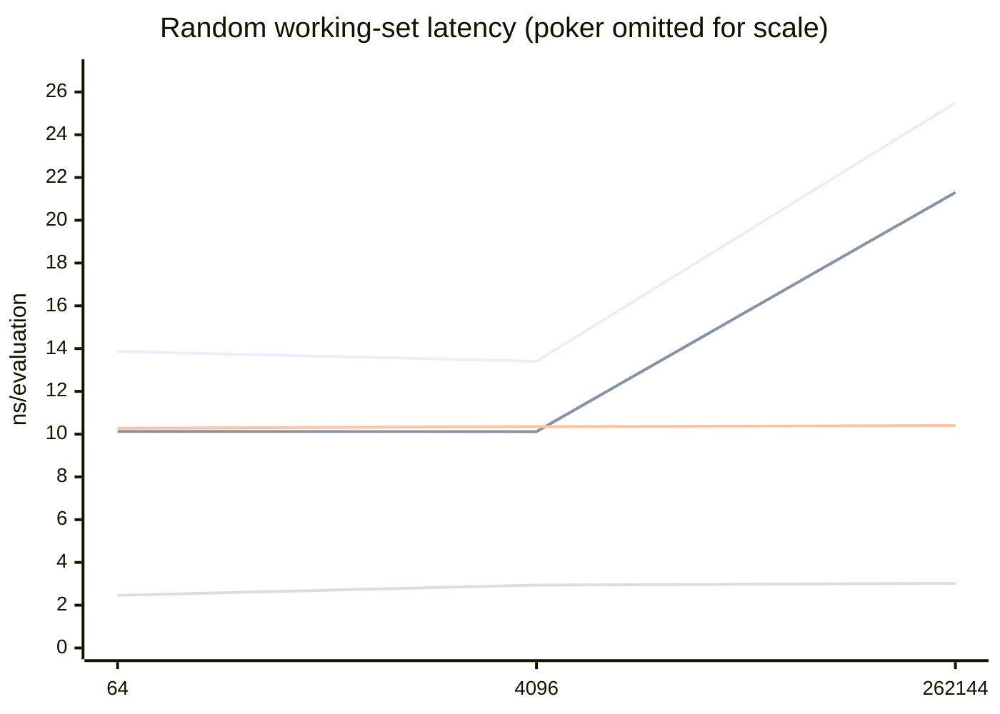
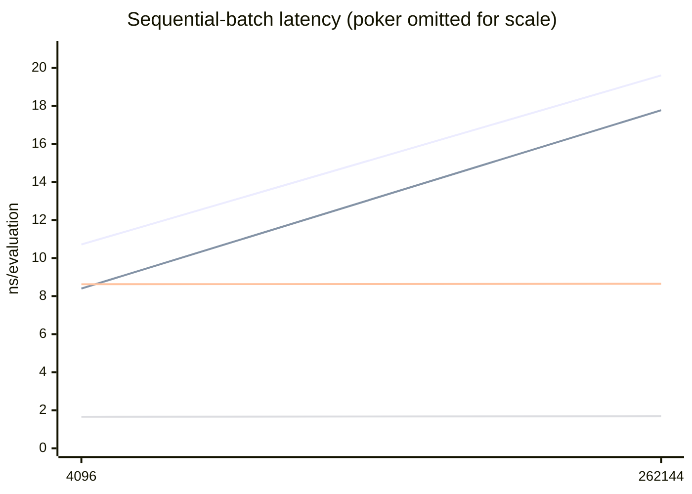

# Comprehensive evaluator comparison — 2026-10-12

## Result status

The Criterion portion of this run is complete: all 77 configured cases have a `new/estimates.json`, all 77 benchmark identifiers are unique, and the console log contains no benchmark error or panic. The runner's final failure was a bookkeeping error after the measurements, not a Criterion failure.

The six reported failures were, exactly:

- `memory probe noop failed: exit code `
- `memory probe eval7-formula failed: exit code `
- `memory probe eval7 failed: exit code `
- `memory probe rs_poker failed: exit code `
- `memory probe aya_poker failed: exit code `
- `memory probe poker failed: exit code `

Each probe actually started, printed a complete record, remained alive for the requested three-second sampling interval, produced an empty stderr file, and contributed a row to `raw/memory.csv`. Windows PowerShell read `System.Diagnostics.Process.ExitCode` as `$null` after `WaitForExit()`. Because `$null -ne 0` is true in this context, every successful probe was recorded as a failure. The runner now refreshes the process object, confirms `HasExited`, rejects an unavailable exit code explicitly, and then compares the integer exit code.

Two reporting defects were also found and fixed for future runs:

- the result parser recursively included both Criterion's `base` and `new` estimates, so the generated summary and CSV repeated every result exactly twice;
- PowerShell interpreted Markdown backticks before `raw/` and `noop` as carriage-return/newline escapes, corrupting those words in `summary.md`;
- the catch handler copied a redundant `criterion-partial` tree even when the complete Criterion tree had already been preserved.

The existing run directory, including its flawed generated summary, duplicate CSV rows, logs, and redundant copy, has deliberately not been changed. This report reads only the 77 `new` estimates. No measurement is missing. The process-memory values are usable as approximate snapshots, although the runner did not retain their successful exit codes. The only Criterion warning was that `sequential_batch/262144/rs_poker` needed about 7.5 seconds rather than the configured 5 seconds to collect 80 samples; Criterion automatically extended collection and wrote a complete estimate.

Raw evidence is in `benchmark-results/20261012-160713/` (intentionally Git-ignored).

## Environment and versions

| Item | Value |
|---|---|
| Source revision | `fd04ee3d20dbfbc0fa81fbe40c5a9c53e636d993` |
| Initial worktree | Clean |
| CPU | AMD Ryzen 9 7950X3D, 16 cores / 32 logical processors |
| OS | Windows 11 Pro 64-bit, version 10.0.26200, build 26200 |
| Rust | `rustc 1.96.1 (31fca3adb 2026-06-26)`, x86_64-pc-windows-msvc, LLVM 22.1.2 |
| Cargo | 1.96.1 |
| RUSTFLAGS | Unset; generic target defaults |
| Profiles | `codegen-units = 1`, thin LTO; Criterion `bench`, probes `release` |
| Criterion | 0.8.2; 3 s warm-up, 5 s requested measurement, 80 samples, plots disabled |
| Eval7-RS | Local 0.1.0 at the source revision above |
| rs_poker | Exactly 5.0.0, default features disabled |
| aya_poker | Exactly 0.1.0, default features disabled |
| poker | Exactly 0.7.0, default features disabled |

The full transitive dependency resolution is preserved in `raw/cargo-tree.txt` and pinned by `tools/comparison-benchmarks/Cargo.lock`.

No processor-affinity mask was set. Windows controlled core placement and frequency. That matters on a 7950X3D because scheduling, boost state, and placement on its asymmetric CCD/cache topology can affect memory-sensitive results. The intervals below quantify within-run sampling uncertainty; they do not quantify run-to-run scheduling or frequency variation.

## Methodology

The suite builds equivalent native seven-card representations before timing. Card IDs are suit-major (`clubs`, `diamonds`, `hearts`, `spades`), with ranks `2` through `A`; each adapter maps that same ID explicitly into the target crate. Timed evaluation therefore excludes construction of each library's native hand type. Conversion costs are measured separately.

Random datasets use a deterministic affine permutation of the lexicographic ranks of all C(52,7) combinations:

`(42,424,243 + index * 1,000,003) mod 133,784,560`

The stride is coprime to C(52,7), so traversal has no repeats over a full cycle. A prefix is deterministic and without replacement, but it is not an independent random sample. “Random” below means this reproducible, dispersed traversal.

Individual cases cycle through a prebuilt native-hand array. Each copied hand passes through `black_box`, and each result passes through `black_box`. Batch cases pass the input slice through `black_box` and consume every result. Inputs are created at runtime rather than as compile-time answers. The external calls may inline, which is appropriate for measuring optimized public APIs; the barriers prevent the compiler from replacing the evaluation with fixture-specific constants.

The principal comparison is an API/architecture comparison, not an assertion that every crate performs the same amount of work after the timer starts:

- Eval7 unchecked performs suit canonicalisation, formula indexing, and a dense rank-table lookup. Checked Eval7 additionally validates seven distinct cards.
- `aya_poker::Hand` already contains an accumulated key and mask when timing begins; `poker_rank` selects a flush/non-flush compact perfect-hash table.
- `rs_poker::Hand` is also prebuilt. Its normal rank path accumulates/evaluates the hand, while the separately labelled `rs_poker_shared_prefix` case intentionally reuses the five-card board accumulator and adds only two hole cards.
- `poker` receives a prebuilt seven-card array and evaluates the best five-card hand through its documented API.

Thus the timings answer “how quickly can each library rank its preferred already-converted representation?” Conversion and validation differences remain visible in the API-overhead section.

## Correctness and semantic validity

Before measurement, the release preflight passed:

- 20,000 hands with identical categories across all four evaluators;
- 19,999 adjacent hand-pair comparisons with identical `Ord` outcomes across all four evaluators;
- one deliberately constructed cross-suit tie with `Ordering::Equal` across all four.

This checks category order, within-category strength, and tie semantics over a substantial deterministic sample. It does not constitute an exhaustive cross-library proof. Eval7's separate exhaustive report covers all 133,784,560 hands against its ported direct evaluator, but that result does not exhaustively validate the three external libraries.

All fixed-board cases use the same five board IDs and enumerate the same 1,081 legal two-card completions. Every other measured hand originates from the same ID array before conversion. None of the evaluator implementations contains answers specific to these fixtures.

## Criterion results

Each result cell is `mean ns/evaluation [95% mean CI]; million evaluations/s; speed relative to Eval7 unchecked`. A speed above 1.00× is faster than Eval7 unchecked for that workload. Throughput is the reciprocal of the displayed unrounded mean.

Abbreviations: E7-C = Eval7 checked; E7-U = Eval7 unchecked; RS = rs_poker; Aya = aya_poker.

### Random working sets

| Hands | E7-C | E7-U | RS | Aya | poker |
|---:|---|---|---|---|---|
| 64 | 13.867 [13.809, 13.928]; 72.1 M/s; 0.73× | 10.123 [10.086, 10.162]; 98.8 M/s; 1.00× | 10.275 [10.246, 10.305]; 97.3 M/s; 0.99× | 2.459 [2.448, 2.472]; 406.6 M/s; 4.12× | 92.507 [92.174, 92.862]; 10.8 M/s; 0.11× |
| 4,096 | 13.406 [13.364, 13.452]; 74.6 M/s; 0.75× | 10.119 [10.084, 10.158]; 98.8 M/s; 1.00× | 10.348 [10.320, 10.379]; 96.6 M/s; 0.98× | 2.938 [2.930, 2.947]; 340.4 M/s; 3.44× | 97.205 [96.818, 97.614]; 10.3 M/s; 0.10× |
| 262,144 | 25.491 [24.953, 26.201]; 39.2 M/s; 0.84× | 21.303 [20.508, 22.385]; 46.9 M/s; 1.00× | 10.402 [10.367, 10.439]; 96.1 M/s; 2.05× | 3.022 [3.016, 3.027]; 330.9 M/s; 7.05× | 101.779 [101.569, 102.036]; 9.8 M/s; 0.21× |



Series order in the chart is E7-C, E7-U, RS, Aya.

### Repeated pools

| Pool | E7-C | E7-U | RS | Aya | poker |
|---:|---|---|---|---|---|
| 1 | 12.807 [12.758, 12.859]; 78.1 M/s; 0.72× | 9.251 [9.213, 9.296]; 108.1 M/s; 1.00× | 10.174 [10.144, 10.208]; 98.3 M/s; 0.91× | 2.425 [2.411, 2.441]; 412.4 M/s; 3.82× | 88.930 [88.607, 89.287]; 11.2 M/s; 0.10× |
| 8 | 13.454 [13.416, 13.496]; 74.3 M/s; 0.73× | 9.884 [9.848, 9.923]; 101.2 M/s; 1.00× | 10.227 [10.185, 10.272]; 97.8 M/s; 0.97× | 2.435 [2.423, 2.448]; 410.7 M/s; 4.06× | 89.573 [89.406, 89.763]; 11.2 M/s; 0.11× |
| 64 | 13.571 [13.537, 13.609]; 73.7 M/s; 0.74× | 10.007 [9.972, 10.058]; 99.9 M/s; 1.00× | 10.254 [10.229, 10.281]; 97.5 M/s; 0.98× | 2.452 [2.444, 2.460]; 407.9 M/s; 4.08× | 92.002 [91.691, 92.365]; 10.9 M/s; 0.11× |
| 1,024 | 13.145 [13.110, 13.183]; 76.1 M/s; 0.75× | 9.821 [9.797, 9.849]; 101.8 M/s; 1.00× | 10.396 [10.354, 10.444]; 96.2 M/s; 0.94× | 2.902 [2.892, 2.914]; 344.6 M/s; 3.38× | 94.157 [93.828, 94.521]; 10.6 M/s; 0.10× |

### Fixed boards

| Texture | E7-C | E7-U | RS | Aya | poker |
|---|---|---|---|---|---|
| Dry | 13.073 [12.968, 13.186]; 76.5 M/s; 0.71× | 9.295 [9.261, 9.340]; 107.6 M/s; 1.00× | 10.152 [10.123, 10.184]; 98.5 M/s; 0.92× | 2.417 [2.413, 2.421]; 413.7 M/s; 3.85× | 91.548 [91.356, 91.768]; 10.9 M/s; 0.10× |
| Paired | 13.105 [12.999, 13.222]; 76.3 M/s; 0.72× | 9.393 [9.374, 9.414]; 106.5 M/s; 1.00× | 10.163 [10.128, 10.202]; 98.4 M/s; 0.92× | 2.435 [2.430, 2.441]; 410.7 M/s; 3.86× | 91.252 [91.001, 91.521]; 11.0 M/s; 0.10× |
| Monotone | 12.605 [12.560, 12.663]; 79.3 M/s; 0.72× | 9.123 [9.102, 9.145]; 109.6 M/s; 1.00× | 10.393 [10.362, 10.427]; 96.2 M/s; 0.88× | 3.214 [3.206, 3.222]; 311.2 M/s; 2.84× | 101.013 [100.825, 101.250]; 9.9 M/s; 0.09× |
| Connected | 12.929 [12.848, 13.015]; 77.3 M/s; 0.71× | 9.208 [9.176, 9.255]; 108.6 M/s; 1.00× | 10.082 [10.061, 10.107]; 99.2 M/s; 0.91× | 2.466 [2.462, 2.471]; 405.5 M/s; 3.73× | 91.840 [91.691, 92.014]; 10.9 M/s; 0.10× |

The specialized RS shared-prefix results are not directly equivalent to ranking a prebuilt seven-card hand because they deliberately reuse the five-card board state:

| Texture | rs_poker shared prefix |
|---|---|
| Dry | 2.808 [2.801, 2.815] ns; 356.2 M/s; 3.31× E7-U |
| Paired | 2.822 [2.811, 2.833] ns; 354.4 M/s; 3.33× E7-U |
| Monotone | 2.859 [2.853, 2.866] ns; 349.7 M/s; 3.19× E7-U |
| Connected | 2.809 [2.802, 2.817] ns; 356.0 M/s; 3.28× E7-U |

### Sequential batches

| Hands/batch | E7-C | E7-U | RS | Aya | poker |
|---:|---|---|---|---|---|
| 4,096 | 10.716 [10.679, 10.763]; 93.3 M/s; 0.78× | 8.399 [8.376, 8.427]; 119.1 M/s; 1.00× | 8.625 [8.602, 8.651]; 115.9 M/s; 0.97× | 1.652 [1.649, 1.657]; 605.2 M/s; 5.08× | 90.143 [89.921, 90.383]; 11.1 M/s; 0.09× |
| 262,144 | 19.603 [19.438, 19.834]; 51.0 M/s; 0.91× | 17.772 [17.349, 18.244]; 56.3 M/s; 1.00× | 8.648 [8.619, 8.685]; 115.6 M/s; 2.06× | 1.692 [1.689, 1.696]; 590.9 M/s; 10.50× | 96.070 [95.870, 96.294]; 10.4 M/s; 0.18× |



Series order in the chart is E7-C, E7-U, RS, Aya.

### API overheads

| Operation | Mean ns [95% CI] | Throughput |
|---|---:|---:|
| Eval7 duplicate validation | 2.446 [2.440, 2.452] | 408.9 M/s |
| Eval7 method unchecked, one fixed hand | 9.377 [9.351, 9.405] | 106.6 M/s |
| Eval7 free function unchecked, one fixed hand | 9.213 [9.173, 9.254] | 108.5 M/s |
| Convert one card: Eval7 | 0.735 [0.733, 0.737] | 1,360.2 M/s |
| Convert one card: rs_poker | 3.794 [3.773, 3.815] | 263.6 M/s |
| Convert one card: aya_poker | 1.423 [1.420, 1.426] | 703.0 M/s |
| Convert one card: poker | 1.740 [1.737, 1.743] | 574.8 M/s |
| Convert one complete set of four native hands | 25.401 [25.340, 25.470] | 39.4 M sets/s |

The standalone validation result is not additive proof that checked minus unchecked must equal 2.446 ns: those benchmarks have different control-flow and optimizer contexts. The checked/unchecked differences in the workload tests are the relevant end-to-end costs.

## Interpretation

### Why Aya is 3–4× faster on small working sets

Confirmed observations:

- Aya takes 2.459 ns at 64 hands and 2.938 ns at 4,096, versus Eval7 unchecked at 10.123 and 10.119 ns.
- Aya's generated hold'em lookup data in this exact build contains 80,165 rank `u16`s plus 14,280 `u32` pilots, and 4,969 flush `u16`s plus 984 `u32` pilots: 231,324 bytes of core table payload in total.
- Aya's timed `Hand` is a 16-byte accumulated key/mask value. `poker_rank` checks the already-accumulated flush state and performs a compact perfect-hash lookup. Hand/card insertion is outside the evaluation timer and separately disclosed.
- Eval7 performs canonicalisation and formula indexing and addresses a 6,009,159-entry rank table. Its embedded file is 12,018,382 bytes including the 64-byte header; the payload is 12,018,318 bytes.

The compact tables, smaller timed operation, and already-accumulated Aya hand make the observed advantage technically plausible. The barriers and runtime-built hand arrays provide no evidence of constant folding or fixture-specific answers. A likely additional contributor is that Aya's roughly 231 KiB core lookup payload has much better cache residency than Eval7's roughly 12 MiB payload. That cache explanation is a hypothesis, not a measured hardware-counter result.

Aya's monotone-board result is slower (3.214 ns versus 2.417–2.466 ns for the other textures). A monotone five-card board guarantees the flush path, and Aya's source selects its flush perfect-hash table when `has_flush()` is true. The path distinction is confirmed; the precise cost attribution would require counters or disassembly analysis.

### Why Eval7 nearly doubles at 262,144 hands

Eval7 unchecked is effectively flat from 64 to 4,096 hands (10.123 to 10.119 ns), then rises to 21.303 ns at 262,144. Checked Eval7 similarly rises from 13.867/13.406 to 25.491 ns. Batch Eval7 shows the same shape, 8.399 to 17.772 ns.

The algorithm and table are unchanged between those cases. The larger deterministic traversal spreads accesses across far more of the 12 MiB rank payload and uses about 1.75 MiB merely for the 262,144 seven-byte Eval7 hand arrays, whereas small/repeated pools continually revisit a small set of lookup locations. Cache-locality loss is therefore the leading hypothesis and is consistent across both individual and batch tests. It is not conclusive: the suite collected no cache-miss counters, fixed no core affinity, and ran on a processor whose CCD placement changes available last-level cache. Page/TLB behavior and scheduler/frequency variation are also possible contributors.

### Why rs_poker stays stable

RS ranges only from 10.275 to 10.402 ns across the three random working sets and from 8.625 to 8.648 ns in batches. Version 5.0.0's generated evaluator uses a 131,072-entry `u16` non-flush lookup, an 8,192-entry `u16` flush lookup, and an 8,192-entry `u32` row-offset table—311,296 bytes (304 KiB) before the small per-card constants. This is dramatically smaller than Eval7's payload, and its stability is consistent with the evaluator tables remaining cache-resident. Again, that causal explanation is inferred from source structure and timing shape; no hardware counters were recorded.

The 2.808–2.859 ns shared-prefix figures demonstrate a separate solver-oriented API advantage: board accumulation is removed from each evaluation. They must not be presented as the normal seven-card `rs_poker` result.

### Why batches are faster

At 4,096 hands, batch timings improve from the corresponding individual random case for every implementation: Eval7 unchecked 10.119 to 8.399 ns, checked 13.406 to 10.716, RS 10.348 to 8.625, Aya 2.938 to 1.652, and poker 97.205 to 90.143.

The batch loop amortizes Criterion closure invocation, cursor update/wrap logic, and some barrier overhead across thousands of evaluations. It also exposes independent sequential iterations to compiler scheduling and hardware prefetch/latency overlap. Aya's compact, pre-accumulated hand representation particularly benefits from this loop shape. The data-dependent rank results are still consumed, so this is not dead-code elimination. Auto-vectorization or instruction-level parallelism was not measured separately; treating either as the sole cause would be speculation.

### Board texture

Eval7 unchecked spans 9.123–9.393 ns across textures, a 0.270 ns or approximately 3.0% range. Checked Eval7 spans 12.605–13.105 ns, approximately 4.0%. Several intervals do not overlap, so texture-associated variation is statistically visible within this run, but it is small in practical terms. Eval7 is fastest on the monotone board here, unlike Aya and poker. Possible causes include different canonical keys, formula paths, and lookup-address locality; the benchmark cannot isolate them.

Aya changes much more on the monotone board because its flush path is structurally distinct. Poker also increases from roughly 91–92 ns to 101 ns, while RS moves from roughly 10.1 to 10.4 ns. These are observed associations, not a proof that suit texture alone caused every difference; each board also has different ranks and enumeration order.

## Startup and memory probes

Startup values are 20 separate process observations per evaluator. They are medians with full observed ranges, not Criterion estimates and not confidence intervals. `warm_1000` is the duration of an internal 1,000-iteration loop; the per-evaluation column is only its median divided by 1,000.

| Probe | Initialization median (range), ns | First operation median (range), ns | Warm 1,000 median (range), ns | Warm ns/op |
|---|---:|---:|---:|---:|
| noop | 900 (600–3,100) | 750 (600–1,900) | 2,100 (2,100–3,200) | 2.10 |
| Eval7 formula only | 447,000 (396,500–509,300) | 1,300 (1,100–2,800) | 2,400 (2,300–2,800) | 2.40 |
| Eval7 | 414,000 (389,700–533,400) | 2,950 (2,600–9,500) | 8,600 (8,400–8,900) | 8.60 |
| rs_poker | 800 (700–1,200) | 3,550 (3,200–13,500) | 10,350 (10,100–10,800) | 10.35 |
| aya_poker | 850 (700–1,100) | 2,900 (2,600–10,500) | 3,700 (3,600–6,100) | 3.70 |
| poker | 195,500 (183,300–260,700) | 1,450 (1,200–5,000) | 83,600 (82,300–93,500) | 83.60 |

Eval7's roughly 0.4 ms construction is confirmed and closely matches the formula-only probe. The probe reports 1,319,072 requested heap bytes plus 40 inline bytes for the formula support structure.

Memory is a one-time Windows process snapshot taken after touching 20,000 hands. It is not allocator-exclusive, page-residency-stabilized, or statistically sampled. Deltas use the noop process from the same run.

| Probe | Working set | WS delta vs noop | Private bytes | Private delta vs noop |
|---|---:|---:|---:|---:|
| noop | 4,415,488 | — | 618,496 | — |
| Eval7 formula only | 5,767,168 | +1,351,680 | 1,982,464 | +1,363,968 |
| Eval7 | 17,747,968 | +13,332,480 | 1,961,984 | +1,343,488 |
| rs_poker | 4,755,456 | +339,968 | 663,552 | +45,056 |
| aya_poker | 4,657,152 | +241,664 | 634,880 | +16,384 |
| poker | 4,677,632 | +262,144 | 884,736 | +266,240 |

Eval7's working-set delta is consistent with resident embedded table pages plus formula support data. Its small private-byte delta relative to working set is also consistent with the rank table being a read-only image mapping rather than heap allocation. These are approximate process-level observations, not exact attribution.

## Limitations and fairness considerations

- This is one complete run on one machine without affinity or frequency control. Do not treat narrow Criterion intervals as cross-machine or cross-run guarantees.
- Benchmark groups run in a fixed order rather than a randomized order, so thermal, frequency, and scheduling drift may be confounded with group order.
- The 7950X3D can schedule work on CCDs with different cache characteristics. No ETW, performance counters, cache-miss data, or effective-clock telemetry was collected.
- The deterministic affine traversal is repeatable and non-repeating, but its prefixes are not IID random samples.
- Native-hand construction is excluded. This favors libraries that store more derived state in their hand representation; conversion costs are disclosed separately but are not automatically additive.
- Only Eval7 exposes checked and unchecked paths in this suite. The competitors receive fixtures already known to be valid, and their duplicate-validation policies are outside the timed work.
- External rank encodings differ. The suite compares semantic category and `Ord` behavior, not raw integer equality across crates.
- The competitor cross-check covers 20,000 categories, 19,999 adjacent comparisons, and one tie, not all possible pairs or hands.
- The exceptionally fast Aya result survived the source, fixture, barrier, and correctness audit, but should still be reproduced with processor affinity and, ideally, hardware counters before drawing a definitive microarchitectural conclusion.
- The memory-probe exit-status records are invalid because of the runner bug; the snapshots and stdout records are present and internally complete.
- The Criterion console log contains cosmetic UTF-8 mojibake for the microsecond symbol under Windows PowerShell. The JSON estimates are numeric and unaffected. No path or subprocess-launch failure was found.

## Reproduction

From a PowerShell prompt at the repository root:

```powershell
.\tools\comparison-benchmarks\run.ps1
```

To constrain the PowerShell process and its children to selected logical processors, provide a hexadecimal mask:

```powershell
.\tools\comparison-benchmarks\run.ps1 -AffinityMask 0x0000000F
```

For correctness-only preparation, without performance measurements:

```powershell
.\tools\comparison-benchmarks\run.ps1 -ValidateOnly
```

The runner creates a timestamped directory under `benchmark-results/`, records the exact Git revision and dirty state in `metadata.md`, preserves Criterion's raw `new`, `base`, sample, and change data, saves console logs and probe output, and writes a de-duplicated summary from `new` estimates only.

No targeted probe rerun is required for the 2026-10-12 analysis: all six stdout records and all six memory snapshots already exist. If exit-code confirmation is desired later, rerun only the probe phase after adding a dedicated runner switch rather than rerunning all 77 Criterion cases; such a switch was not added as part of this diagnostic fix because it would expand the runner interface beyond the issue being corrected.
